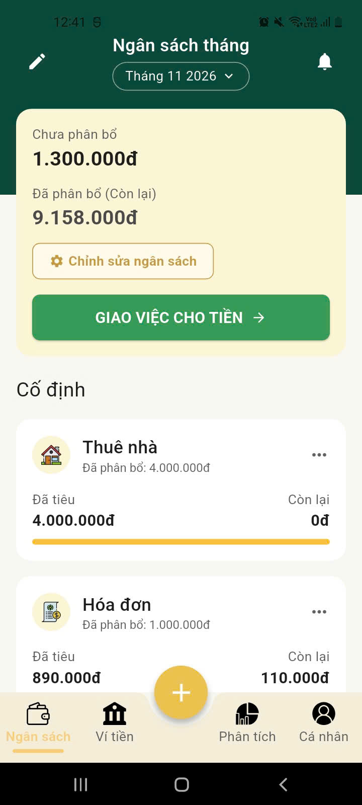
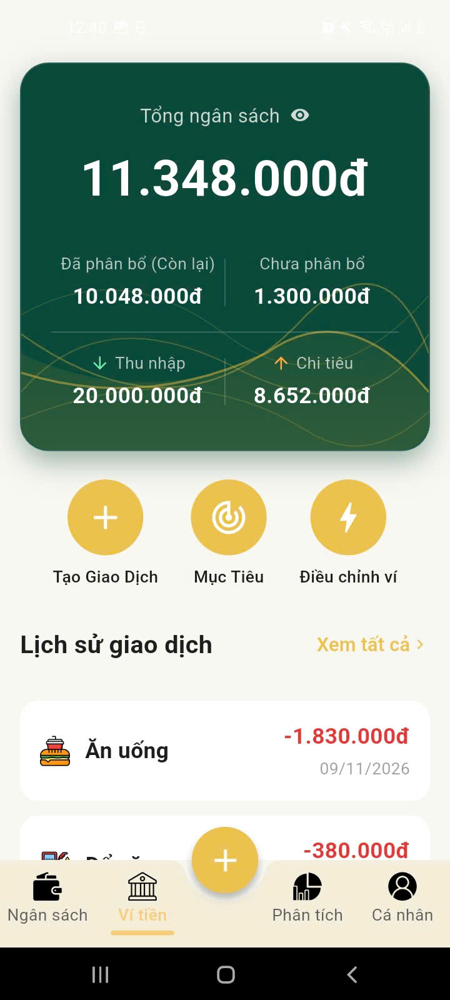
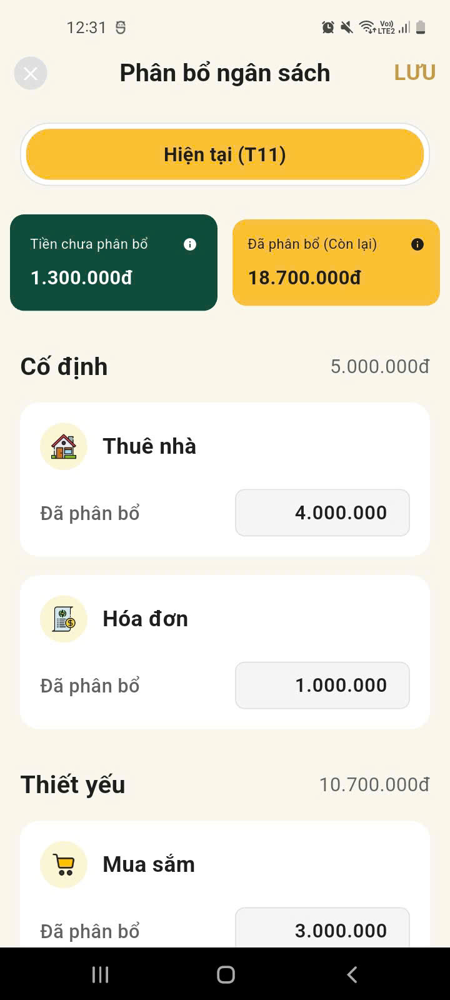
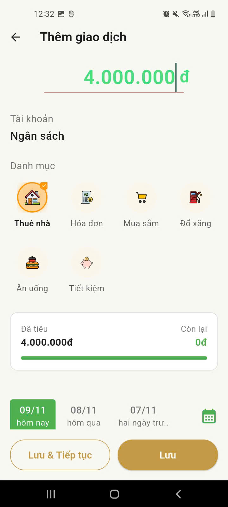
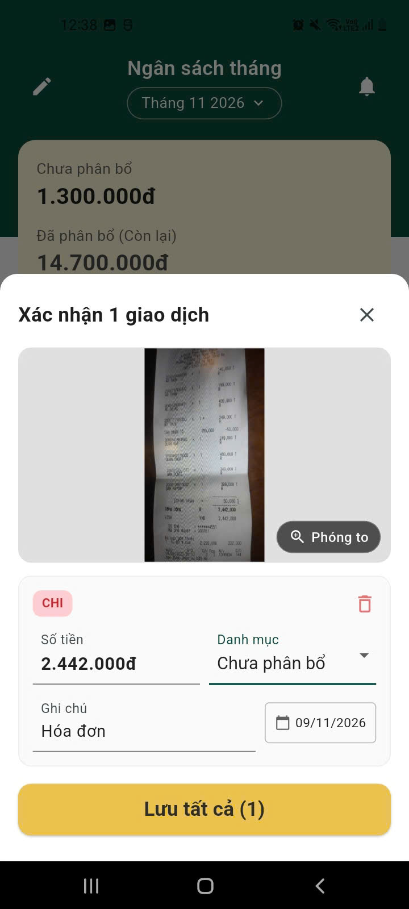
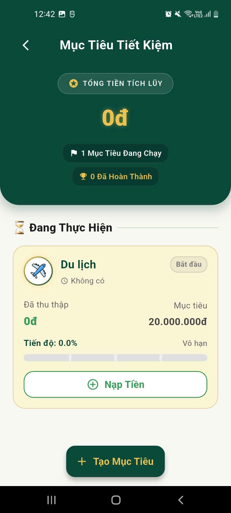
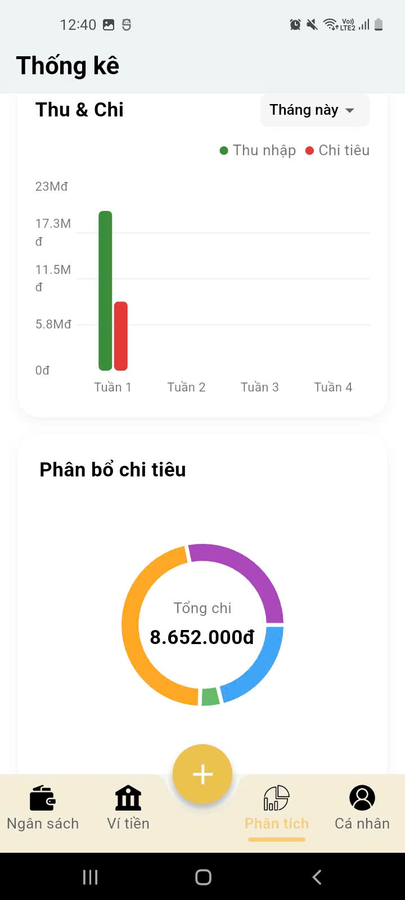

<div align="center">

  <h1>🐷 Pigo</h1>
  <p><strong>AI-Powered Personal Finance & Smart Budget Manager</strong></p>
  <p>An offline-first, intelligent mobile assistant engineered with Flutter, Clean Architecture, and Multi-Modal AI.</p>

  <p>
    
    
    
    
    
    
  </p>
</div>

---

## 📱 App Previews

<div align="center">

### 1. 🏠 Home & Budget Management
| Home Page | Total Budget Overview | Budget Distribution |
| :---: | :---: | :---: |
|  |  |  |
| **Trang chủ & Số dư ví** | **Tổng quan ngân sách** | **Phân chia ngân sách** |

<br />

### 2. ⚡ Multi-Modal Transaction Input
| Create Transaction (Smart NLP) | Receipt OCR Scanning |
| :---: | :---: |
|  |  |
| **Tạo giao dịch thông minh (NLP/Voice)** | **Quét hóa đơn bằng ML Kit OCR** |

<br />

### 3. 🎯 Goals & Analytics
| Savings Goal | Financial Statistics |
| :---: | :---: |
|  |  |
| **Theo dõi mục tiêu tiết kiệm** | **Báo cáo phân tích thống kê** |

</div>

---

## 💡 Key Highlights

### 🔒 100% Offline-First & Privacy Centric
- **Zero Cloud Lock-in**: All financial records, category budgets, and user preferences are stored securely on-device using a robust **SQLite (`sqflite`)** database with foreign keys and multi-column indexes.
- Complete data privacy: Your sensitive financial numbers never leave your device unless explicitly using optional cloud AI fallback.

### 🎙️ Multi-Modal Smart Transaction Input
- **Natural Language Parsing (NLP)**: Log transactions by typing colloquial Vietnamese (e.g., *"ăn phở bò 45k"*, *"mua sắm siêu thị 350k"*). The custom parser instantly extracts category, numeric amount, and timestamps.
- **Voice-to-Transaction**: Integrated Speech-to-Text for hands-free audio recording and automated transcription.
- **Receipt OCR Scanning**: Integrated **Google ML Kit Text Recognition** to capture paper receipts and invoices, parse total charges, and match them with appropriate budget categories.
- **Graceful Fallback Pipeline**: Fast-path On-Device rule parser (<1ms, zero cost) with graceful fallback to Cloud AI for complex sentence structures.

### 💰 Comprehensive Budgeting & Monthly Rollover
- **Category Allocation**: Group budgets into distinct financial buckets (Fixed, Essential, Discretionary, Savings).
- **Automated Rollover**: Month-end transition handling that reconciles unspent surpluses and accommodates overspending compensation.
- **Multi-Month Gap Detection**: Automatically synchronizes and recalibrates account state even if the app hasn't been opened for months.

### 🎯 Savings Goals & Inter-Category Transfers
- Set target savings goals with progress tracking and celebratory completion feedback (**Confetti** effects).
- Flexible money movement between category budgets and savings pots with full audit transfer logs.

### 📊 Rich Analytics & Data Visualization
- Interactive charts powered by **`fl_chart`**:
  - **Donut Chart**: Expense distribution by categories.
  - **Income vs. Expense Bar Chart**: Visual comparison across customizable timeframes.
  - **Trend Area Chart**: Cash flow and spending patterns over time.
  - **Category Deep Dive**: Drill-down analysis for specific category history.

### ⚡ Performance & Data Retention
- **In-Memory Caching**: Cache mixins to eliminate redundant disk I/O on frequently accessed transactions.
- **Automated Data Retention Service**: Background archival system that aggregates historical transactions older than 2 months into summary tables, pruning raw records to maintain a lightweight SQLite footprint and instant screen load times.
- **Functional Error Handling**: Implemented with **`dartz` (`Either<Failure, T>`)** to enforce predictable state transitions and eliminate unhandled runtime exceptions.

---

## 🏗️ Architecture & Project Structure

The project strictly follows **Clean Architecture** combined with **Feature-First modularization** using **GetX**:

```
lib/
├── core/                   # Shared infrastructure & utilities
│   ├── base/               # BaseController, BaseView
│   ├── constants/          # Asset paths, storage keys, colors
│   ├── enums/              # UI states, rollover states, transaction types
│   ├── errors/             # Custom exceptions, failure classes, error handlers
│   ├── mixins/             # Cache mixin, network awareness, budget awareness
│   ├── routes/             # AppPages, AppRoutes (GetX routing)
│   ├── services/           # Storage, Notification, Network, Data Retention
│   ├── theme/              # Light & Dark themes, typography
│   └── utils/              # Currency formatters, NLP parser, date helpers
├── data/                   # Data Access Layer
│   ├── data_sources/       # Local SQLite database, mixins, AI engines
│   ├── models/             # Data transfer models (JSON/Map serialization)
│   └── repositories/       # Concrete repository implementations
├── domain/                 # Business Logic Layer
│   ├── entities/           # Core domain models
│   └── services/           # Service contracts & interfaces
└── ui/                     # Presentation Layer (Feature-Driven)
    ├── features/
    │   ├── auth/           # Login, Register, Onboarding, Splash
    │   ├── budget/         # Budget distribution & category setup
    │   ├── goal/           # Savings goals & progress tracking
    │   ├── home/           # Main dashboard & wallet overview
    │   ├── profile/        # Preferences, data retention, backup
    │   ├── rollover/       # Month-end rollover workflows
    │   ├── smart/          # Multi-modal input (NLP, Voice, OCR)
    │   ├── statistics/     # Charts & spending analytics
    │   ├── transaction/    # Transaction history, details, CRUD
    │   └── wallet/         # Wallet balance & fund adjustments
    └── widgets/            # Reusable UI components & dialogs
```

---

## 🛠️ Tech Stack & Dependencies

| Category | Technologies / Libraries |
|---|---|
| **Framework** | [Flutter](https://flutter.dev/) (SDK `^3.12.1`) |
| **Language** | [Dart](https://dart.dev/) |
| **State Management & DI** | [GetX](https://pub.dev/packages/get) |
| **Local Database** | [sqflite](https://pub.dev/packages/sqflite) (SQLite with indexing & foreign keys) |
| **Key-Value & Secure Storage** | [get_storage](https://pub.dev/packages/get_storage), [flutter_secure_storage](https://pub.dev/packages/flutter_secure_storage) |
| **Functional Error Handling** | [dartz](https://pub.dev/packages/dartz) (`Either`, `Fold`) |
| **Charts & Visualization** | [fl_chart](https://pub.dev/packages/fl_chart) |
| **AI / OCR / Voice** | [google_mlkit_text_recognition](https://pub.dev/packages/google_mlkit_text_recognition), [speech_to_text](https://pub.dev/packages/speech_to_text), [record](https://pub.dev/packages/record) |
| **Networking & HTTP** | [dio](https://pub.dev/packages/dio), [connectivity_plus](https://pub.dev/packages/connectivity_plus) |
| **UI Utilities** | [flutter_screenutil](https://pub.dev/packages/flutter_screenutil), [confetti](https://pub.dev/packages/confetti) |
| **Notifications** | [flutter_local_notifications](https://pub.dev/packages/flutter_local_notifications), [timezone](https://pub.dev/packages/timezone) |
| **Testing** | `flutter_test`, [mockito](https://pub.dev/packages/mockito) |

---

## 🚀 Getting Started

### Prerequisites
- [Flutter SDK](https://docs.flutter.dev/get-started/install) (`>= 3.12.1`)
- Android Studio / VS Code with Flutter extension
- An Android Device / Emulator (API 21+) or iOS Simulator (iOS 12+)

### Installation

1. **Clone the repository:**
   ```bash
   git clone https://github.com/ahntuan0111/RepoApp.git
   cd RepoApp
   ```

2. **Install dependencies:**
   ```bash
   flutter pub get
   ```

3. **Configure Environment Variables (Optional):**
   Create a `.env` file in the root directory if you want to enable Cloud AI fallback:
   ```env
   GROQ_API_KEY=your_groq_api_key_here
   GEMINI_API_KEY=your_gemini_api_key_here
   ```
   *(Note: The app runs 100% offline without any API keys required).*

4. **Run the application:**
   ```bash
   flutter run
   ```

---

## 🧪 Testing

Run the automated test suite (including unit tests, parser benchmarks, and retention service checks):
```bash
flutter test
```

---

## 👤 Author

**Le Anh Tuan**
- GitHub: [@ahntuan0111](https://github.com/ahntuan0111)
- Email: [anhtuan01112004@gmail.com](mailto:anhtuan01112004@gmail.com)

---

## 📄 License

This project is licensed under the [MIT License](LICENSE).
